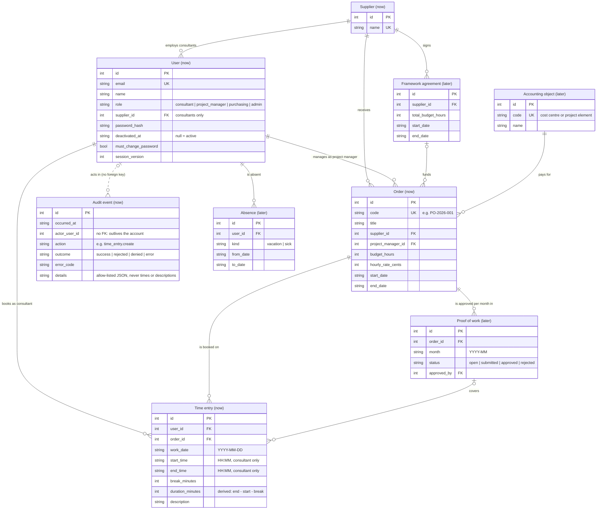

# Domain model

What our product stores and the words we use for it. The diagram follows the database schema in
[schema.ts](../apps/api/src/persistence/schema.ts); when the schema changes, this page changes in the same pull request.

## Glossary

The words used in the code, the API and the UI (German in brackets, as in the app).

| Term | Meaning |
|---|---|
| Client | The large company that buys project work from external suppliers. Project managers, purchasing and admins work on this side. |
| Supplier (Dienstleister) | A service company the client orders work from. It employs the consultants. |
| Consultant (Berater) | A person employed by a supplier who works on an order and books the time. Belongs to exactly one supplier. |
| Order (Bestellung) | The client's purchase order to one supplier: a code such as `PO-2026-001`, a title, a period, a budget in hours and an hourly rate. Every booked hour belongs to one order. |
| Project manager (Projektleitung) | The person on the client side responsible for an order. Sees the bookings on their orders, as durations only. |
| Booking / time entry (Buchung) | One block of work by one consultant on one order on one day: start, end, break, the worked duration and what was done. `time_entries` in the database. |
| Worked duration (Dauer) | End − start − break of a booking, in minutes. Derived by the server, never typed in ([ADR 0010](adr/0010-time-entry-granularity.md)). |
| Budget | What the client ordered: `budget hours × hourly rate`. *Booked* is the sum of all bookings on the order, *remaining* is budget − booked ([ADR 0008](adr/0008-budget-calculation.md)). |
| Person-day (PD, Personentag) | 8 hours. Budgets are shown in hours and person-days; the database stores hours and minutes. |
| Public holiday (Feiertag) | A day on which nobody may book. Today: the holidays valid in every German state, computed in code, not stored ([public-holidays.ts](../apps/api/src/domain/public-holidays.ts)). |
| Working Time Act (ArbZG) | The German law behind several booking rules: at most 10 hours per day, no work on Sundays and public holidays. |
| Audit event | One row per API request: who did what, when, and whether it was allowed. Append-only ([ADR 0012](adr/0012-audit-log.md)). |

## Entity relationship diagram

Entities we **build now** are marked `(now)`, entities of the **next expansion stage** `(later)`. The later stage is
a proposal from the backlog, to confirm with the team; it is not built.

The audit event shows only its key columns; the full list is in [schema.ts](../apps/api/src/persistence/schema.ts).

## Notes

- **One role per user, one table for all.** Consultants, project managers, purchasing and admins are all `users`
  with a `role` ([ADR 0004](adr/0004-role-model-and-accounts.md)). Only consultants have a `supplier_id`; the
  client-side roles do not belong to a supplier.
- **Budget is computed, never stored.** Booked = `SUM(duration_minutes)` of the order's time entries; money =
  minutes × hourly rate, in integer euro cents; person-days = hours ÷ 8. Nothing can drift from the bookings
  ([ADR 0008](adr/0008-budget-calculation.md), [budget.ts](../apps/api/src/domain/budget.ts)).
- **Duration is stored although it is derived.** The server calculates it from start, end and break when booking.
  Storing it keeps the budget and the 10-hour sum a plain SQL `SUM` ([ADR 0010](adr/0010-time-entry-granularity.md)).
- **Times stay with the consultant.** Start, end and break are returned only to the consultant who booked them;
  the client side sees durations or sums ([roles-and-privacy.md](roles-and-privacy.md)).
- **Bookings are never deleted with their user.** A deactivated account keeps its bookings, so the order's budget
  stays correct. The audit log has no foreign key on purpose, so it outlives any account.
- **Not stored:** public holidays (computed from the year) and the remaining budget (computed on read).
- **Next stage, in one sentence each** (proposals, not built):
  - *Framework agreement* – a long-term contract with a supplier whose total budget the orders draw from.
  - *Accounting object* – the cost centre or project element that pays for an order.
  - *Proof of work* – the monthly list of an order's hours that the project manager approves before the invoice.
  - *Absence* – vacation or sick days, so nobody books time on them.
